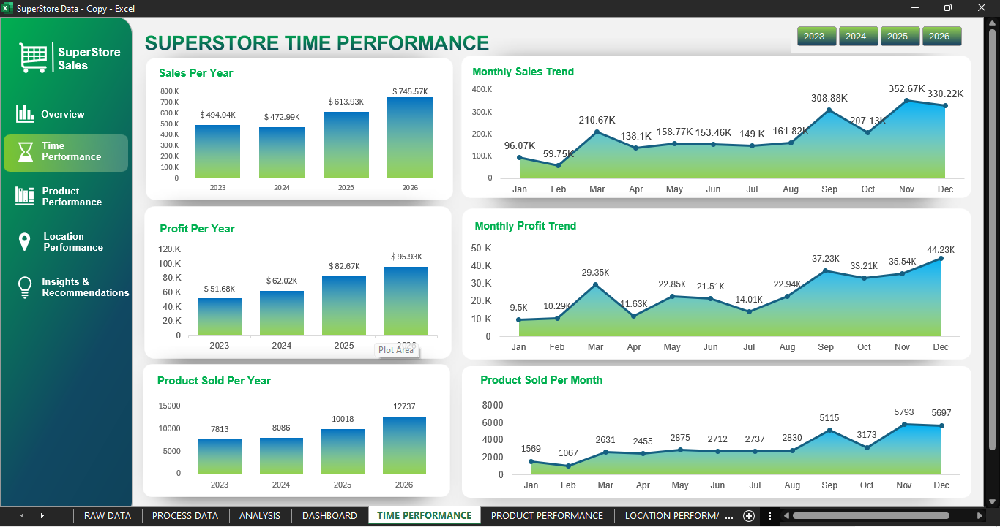

# Superstore Sales Analysis

## Dashboard Preview

The Superstore Sales Dashboard provides an overview of the business's sales and profitability performance using Microsoft Excel. It presents key performance indicators (KPIs) and interactive visualizations to help users understand overall business performance.

### Key Performance Indicators (KPIs)
* Total Sales: Overall sales generated.
* Total Profit: Total profit earned.
* Total Orders: Number of unique orders.
* Total Customers: Number of unique customers.
* Units Sold: Total quantity of products sold.
* Profit Margin: Percentage of sales converted into profit.

### Dashboard Visualizations

* Sales per Year: Compares sales performance across different years.
* Sales vs Profit by Region: Compares sales and profit performance across different regions.
* Sales by Category: Compares sales contributions across product categories.
* Quality Sold by Year: Compares quantity sold  across different years.
* Top 10 Products by Sales: Highlights the products generating the highest sales.

### Interactive Features

The dashboard includes a year slicer that allows users to filter the visualizations by year and explore sales performance for different periods.

### Tools Used

* Microsoft Excel
* PivotTables and PivotCharts
* Slicers
* Excel formulas and data analysis techniques

### Objective

The objective of this dashboard is to transform raw sales data into an organized and interactive visual report that supports business performance monitoring and data-driven decision-making.

## Time Performance Overview

## ⏱️ Superstore Time Performance Dashboard

The **Superstore Time Performance Dashboard** analyzes sales, profit, and product quantity trends over time using Microsoft Excel. It helps identify yearly performance changes and monthly patterns to understand how business performance evolves throughout the year.

### 📊 Key Visualizations

- **Sales per Year** – Compares total sales across different years to identify overall sales growth.
- **Monthly Sales Trend** – Shows monthly sales fluctuations and highlights months with higher or lower sales.
- **Profit per Year** – Compares annual profit to evaluate changes in profitability over time.
- **Monthly Profit Trend** – Tracks monthly profit performance to identify stronger and weaker periods.
- **Products Sold per Year** – Compares the total quantity of products sold each year.
- **Products Sold per Month** – Shows monthly changes in product sales volume.

### 🎛️ Interactive Features

- **Year Slicers** – Filter the dashboard by year to focus on a specific period.
- **Navigation Menu** – Navigate between the Overview, Time Performance, Product Performance, Location Performance, and Insights & Recommendations sections.

### 🛠️ Tools Used

- Microsoft Excel
- PivotTables and PivotCharts
- Slicers and interactive dashboard navigation
- Excel data analysis and visualization techniques

### 🎯 Objective

To transform sales data into meaningful time-based visualizations that help identify trends, compare yearly performance, recognize seasonal patterns, and support data-driven business decisions.

## Product Performance Overview

