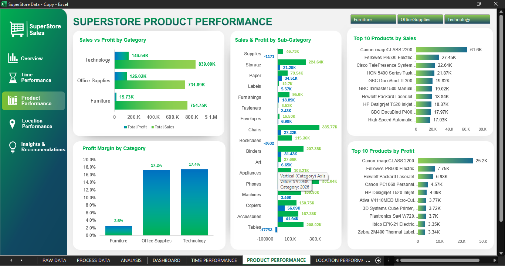
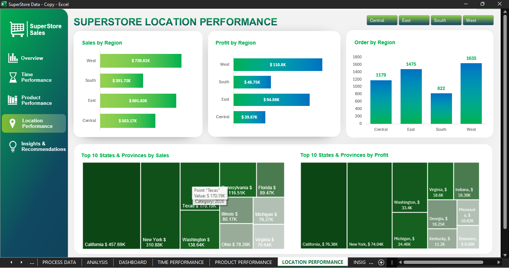
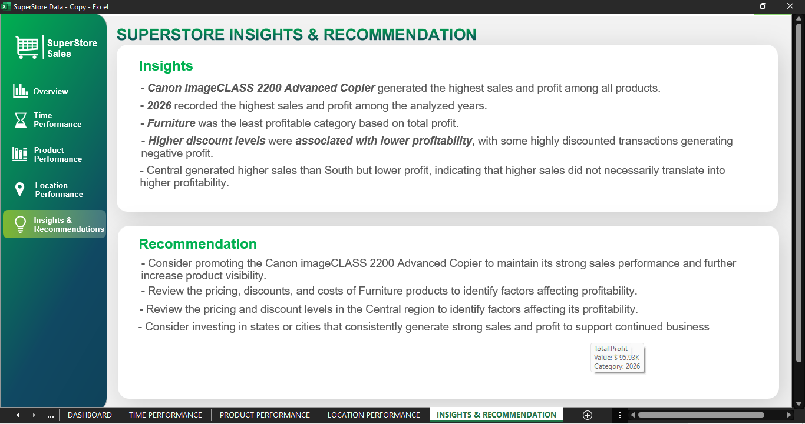

# Superstore Sales Analysis

## Dashboard Preview

The Superstore Sales Dashboard provides an overview of the business's sales and profitability performance using Microsoft Excel. It presents key performance indicators (KPIs) and interactive visualizations to help users understand overall business performance.

### Key Performance Indicators (KPIs)
* Total Sales: Overall sales generated.
* Total Profit: Total profit earned.
* Total Orders: Number of unique orders.
* Total Customers: Number of unique customers.
* Units Sold: Total quantity of products sold.
* Profit Margin: Percentage of sales converted into profit.

### Dashboard Visualizations

* Sales per Year: Compares sales performance across different years.
* Sales vs Profit by Region: Compares sales and profit performance across different regions.
* Sales by Category: Compares sales contributions across product categories.
* Quality Sold by Year: Compares quantity sold  across different years.
* Top 10 Products by Sales: Highlights the products generating the highest sales.

### Interactive Features

The dashboard includes a year slicer that allows users to filter the visualizations by year and explore sales performance for different periods.

### Tools Used

* Microsoft Excel
* PivotTables and PivotCharts
* Slicers
* Excel formulas and data analysis techniques

### Objective

The objective of this dashboard is to transform raw sales data into an organized and interactive visual report that supports business performance monitoring and data-driven decision-making.

## Time Performance Preview

The **Superstore Time Performance Dashboard** analyzes sales, profit, and product quantity trends over time using Microsoft Excel. It helps identify yearly performance changes and monthly patterns to understand how business performance evolves throughout the year.

### 📊 Key Visualizations

- **Sales per Year** – Compares total sales across different years to identify overall sales growth.
- **Monthly Sales Trend** – Shows monthly sales fluctuations and highlights months with higher or lower sales.
- **Profit per Year** – Compares annual profit to evaluate changes in profitability over time.
- **Monthly Profit Trend** – Tracks monthly profit performance to identify stronger and weaker periods.
- **Products Sold per Year** – Compares the total quantity of products sold each year.
- **Products Sold per Month** – Shows monthly changes in product sales volume.

### 🎛️ Interactive Features

- **Year Slicers** – Filter the dashboard by year to focus on a specific period.
- **Navigation Menu** – Navigate between the Overview, Time Performance, Product Performance, Location Performance, and Insights & Recommendations sections.

### 🛠️ Tools Used

- Microsoft Excel
- PivotTables and PivotCharts
- Slicers and interactive dashboard navigation
- Excel data analysis and visualization techniques

### 🎯 Objective

To transform sales data into meaningful time-based visualizations that help identify trends, compare yearly performance, recognize seasonal patterns, and support data-driven business decisions.

## Product Performance Overview

The **Superstore Product Performance Dashboard** analyzes sales, profit, and profitability across product categories and sub-categories using Microsoft Excel. It helps identify top-performing products, compare category performance, and highlight products or categories that may need further analysis.

### 📊 Key Visualizations

- **Sales vs. Profit by Category** – Compares total sales and profit across Furniture, Office Supplies, and Technology to evaluate category performance.
- **Sales & Profit by Sub-Category** – Examines sales and profit across product sub-categories to identify strong performers and areas of concern.
- **Profit Margin by Category** – Compares profit margins across categories to assess profitability relative to sales.
- **Top 10 Products by Sales** – Highlights the products generating the highest sales.
- **Top 10 Products by Profit** – Identifies the products contributing the most to overall profit.

### 🎛️ Interactive Features

- **Category Slicers** – Filter the dashboard by Furniture, Office Supplies, or Technology.
- **Navigation Menu** – Navigate between the Overview, Time Performance, Product Performance, Location Performance, and Insights & Recommendations sections.

### 🛠️ Tools Used

- Microsoft Excel
- PivotTables and PivotCharts
- Slicers and interactive dashboard navigation
- Excel data analysis and visualization techniques

### 🎯 Objective

To evaluate product and category performance, identify top-selling and profitable products, compare profit margins, and support data-driven decisions about product strategy and profitability improvement.

## Location Performance Overview

The **Superstore Location Performance Dashboard** analyzes sales, profit, and order distribution across different regions and states using Microsoft Excel. It helps compare regional performance and identify geographic areas that contribute significantly to the business's sales and profitability.

### 📊 Key Visualizations

- **Sales by Region** – Compares total sales across the Central, East, South, and West regions to identify regions with higher sales.
- **Profit by Region** – Evaluates the profit generated by each region to compare regional profitability.
- **Orders by Region** – Shows the number of orders in each region to understand order distribution.
- **Top 10 States & Provinces by Sales** – Highlights the geographic areas generating the highest sales using a treemap visualization.
- **Top 10 States & Provinces by Profit** – Identifies the states and provinces contributing the most profit.

### 🎛️ Interactive Features

- **Region Slicers** – Filter the dashboard by Central, East, South, or West.
- **Navigation Menu** – Navigate between the Overview, Time Performance, Product Performance, Location Performance, and Insights & Recommendations sections.

### 🛠️ Tools Used

- Microsoft Excel
- PivotTables and PivotCharts
- Treemap visualizations
- Slicers and interactive dashboard navigation
- Excel data analysis and visualization techniques

### 🎯 Objective

To compare geographic sales and profitability, identify high-performing regions and states, understand order distribution, and support data-driven decisions about regional business performance and resource allocation.

## Insights & Recommendations Overview

## 💡 Superstore Insights & Recommendations Dashboard

The **Superstore Insights & Recommendations Dashboard** summarizes key findings from the sales analysis and presents actionable recommendations based on the observed patterns in sales, profit, discounts, and regional performance. It translates data analysis results into business insights that can support informed decision-making.

### 📊 Key Insights

- **Top-Performing Product** – The Canon imageCLASS 2200 Advanced Copier generated the highest sales and profit among all products.
- **Yearly Performance** – 2026 recorded the highest sales and profit among the analyzed years.
- **Category Profitability** – Furniture was the least profitable category based on total profit.
- **Discount and Profitability** – Higher discount levels were associated with lower profitability, with some highly discounted transactions generating negative profit.
- **Regional Performance** – Central generated higher sales than South but lower profit, showing that higher sales did not necessarily translate into higher profitability.

### 💡 Recommendations

- **Promote Top-Performing Products** – Consider promoting the Canon imageCLASS 2200 Advanced Copier to maintain its strong sales performance and increase product visibility.
- **Improve Furniture Profitability** – Review Furniture product pricing, discounts, and costs to identify opportunities to improve profitability.
- **Review Discount Strategies** – Evaluate discount levels and their impact on profit to help reduce unprofitable transactions.
- **Improve Regional Profitability** – Review pricing, discounts, product mix, and costs in the Central region to identify factors affecting its profitability.
- **Focus on High-Performing Locations** – Consider investing in states or cities that consistently generate strong sales and profit to support continued business growth.

### 🛠️ Tools Used

- Microsoft Excel
- PivotTables and PivotCharts
- Excel formulas and data analysis techniques
- Comparative analysis and business insight development
- Dashboard navigation and visual reporting

### 🎯 Objective

To communicate the most important findings from the Superstore analysis and translate them into practical recommendations that can help improve profitability, guide product and regional strategies, and support data-driven business decisions.

