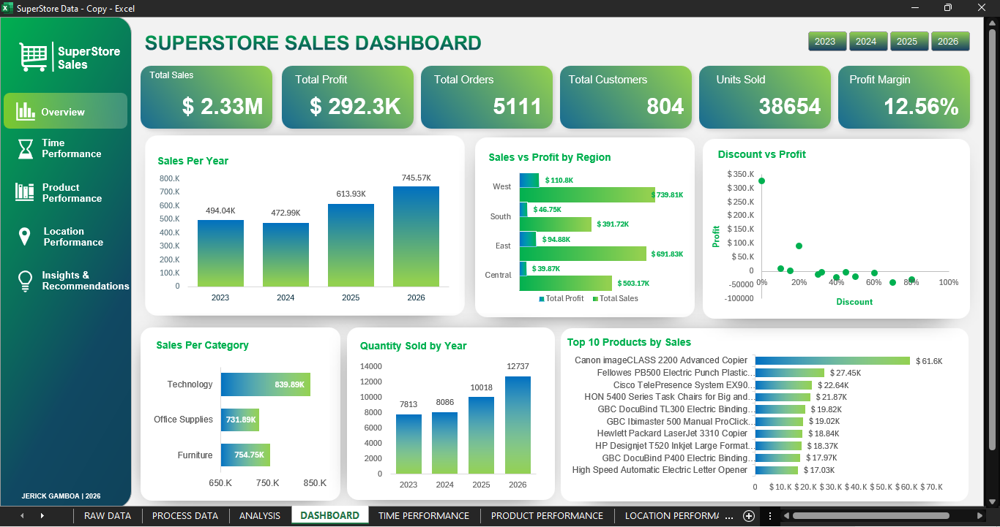

# Superstore Sales Analysis

## Dashboard Preview

The Superstore Sales Dashboard provides an overview of the business's sales and profitability performance using Microsoft Excel. It presents key performance indicators (KPIs) and interactive visualizations to help users understand overall business performance.

### Key Performance Indicators (KPIs)
* Total Sales: Overall sales generated.
* Total Profit: Total profit earned.
* Total Orders: Number of unique orders.
* Total Customers: Number of unique customers.
* Units Sold: Total quantity of products sold.
* Profit Margin: Percentage of sales converted into profit.

### Dashboard Visualizations

* Sales per Year: Compares sales performance across different years.
* Sales vs Profit by Region: Compares sales and profit performance across different regions.
* Sales by Category: Compares sales contributions across product categories.
* Quality Sold by Year: Compares quantity sold  across different years.
* Top 10 Products by Sales: Highlights the products generating the highest sales.

### Interactive Features

The dashboard includes a year slicer that allows users to filter the visualizations by year and explore sales performance for different periods.

### Tools Used

* Microsoft Excel
* PivotTables and PivotCharts
* Slicers
* Excel formulas and data analysis techniques

### Objective

The objective of this dashboard is to transform raw sales data into an organized and interactive visual report that supports business performance monitoring and data-driven decision-making.

## Time Performance Overview

